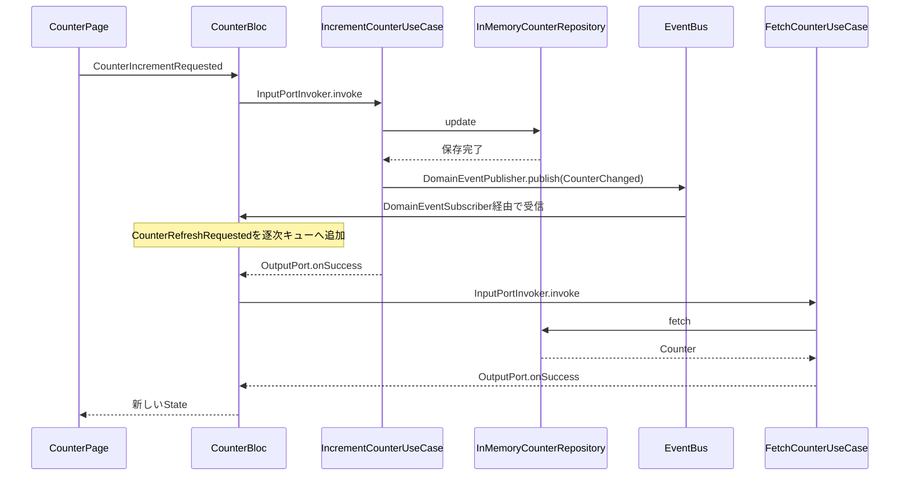
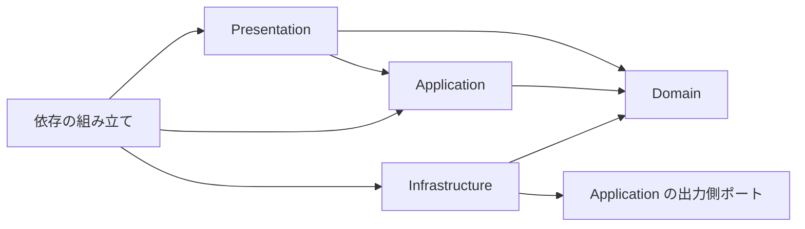

# Flutter Architecture

BLoC、UseCase、Repository、Domain Event の責務と連携を示す Flutter サンプルです。
カウンターで画面操作から保存、DomainEventによる再取得までを確認できます。
「Open another screen」で二つ目の画面を開くと、別々の BLoC が同じ更新イベントを受けて表示を更新します。

## 起動

Flutter 3.47.7を `.tool-versions` で指定しています。

```sh
flutter pub get
flutter run -d chrome
```

「+1」を押すとカウンターが更新されます。
Repositoryはメモリ内に値を保存するため、アプリを再起動すると0に戻ります。
Web用の起動ファイルを含みます。

## 処理の流れ



最初に [依存の組み立て](lib/di/app_dependencies.dart)、[CounterBloc](lib/presentation/bloc/counter/counter_bloc.dart)、[更新UseCase](lib/application/counter/command/increment_counter_use_case.dart) を読むと流れを追えます。

| 配置 | 責務 |
| --- | --- |
| `lib/presentation/bloc/share/bloc/` | BLoCの逐次処理、初期化、State、DomainEventからBLoC Eventへの変換 |
| `lib/application/` | InputPort、OutputPort、Query、VoidCommand、ValueCommand、実行結果の取得 |
| `lib/application/outbound_port/` | DomainEventを発行するための契約 |
| `lib/domain/shared/` | DomainObject、Identifier、DomainEvent、Repositoryの基底契約 |
| `lib/domain/counter/` | Counterと読み取り用、書き込み用Repositoryの契約 |
| `lib/infrastructure/` | メモリ内Repository、EventBus、発行側アダプター |
| `lib/presentation/event/` | DomainEvent購読側の契約とアダプター |
| `lib/di/` | 各層の接続と共有インスタンスの管理 |

UseCaseは入力を検証した後に処理を実行し、成功時は `OutputPort.onSuccess`、失敗時は `OutputPort.onError` に通知します。
BLoCは `InputPortInvoker` で結果を取得します。
Queryは読み取り用Repositoryに依存し、Commandは書き込み用Repositoryと `DomainEventPublisher` に依存します。

DomainEventの発行は保存完了後に行います。
購読側は `TypedDomainEventBinding` で機能固有のBLoC Eventへ変換し、画面操作と同じ逐次キューで処理します。
同じEventBusを使う複数のBLoCへ配信でき、`close()` で購読を解除します。
EventBusは同期配信で、再送や永続化は行いません。
リスナーの例外は発行元へ伝播するため、リスナーではイベントのキュー投入までを行い、非同期処理はBLoC Eventのハンドラへ置きます。

## サンプルの構成

- UseCase の共通依存は Logger とし、Command には DomainEventPublisher も注入します。
- Repositoryは `Repository`、`ReadRepository`、`WriteRepository` の基底契約とカウンター用の操作に絞りました。
- DIはコンストラクタで接続し、Loggerにはサンプル用の `NoopLogger` を注入します。
- 店舗業務、API通信、DB、トランザクション実装は含めていません。
- `build_runner` による生成を必要としない構成です。

## Mason

ローカルのMasonライブラリでBLoCとUseCaseを生成します。
グローバルなMason CLIのインストールは不要です。

```sh
dart run tool/mason/generate_bloc.dart ProductList product/list
dart run tool/mason/generate_use_case.dart FetchProductList query product
dart run tool/mason/generate_use_case.dart SaveProduct command product
```

BLoCは `lib/presentation/bloc/<出力先>/`、UseCaseは `lib/application/<出力先>/query/` または `command/` に配置します。
対応するテストを `test/` にも生成します。
名前はPascalCase、出力先は小文字と数字とアンダースコアを使い、階層を `/` で区切ります。
既存ファイルは上書きしません。

生成したBLoCは空のStateDataで初期化を完了します。
UseCaseは未実装箇所が分かるよう `UnimplementedError` を返す雛形です。
Queryの `Never` を実際の戻り値に置き換え、Repositoryの注入と処理を実装してください。
生成テストも業務上の期待値に変更します。
DomainEventの接続は `CounterBloc` の `domainEventBindings` と更新UseCaseが実装例です。

## Linter

`analysis_options.yaml` でFlutterのlintと、`tool/lint` の独自解析プラグインを有効にしています。
独自ルールは12種類を含み、レイヤーの逆向き依存、QueryでのWriteRepository利用、強制アンラップ、propsの記載漏れなどを検出します。
検出範囲は各ルールの実装に依存します。
Future並列処理やTransactionRunnerなど、このサンプルに含めていないAPI向けのルールは、対応するコードがある場合にだけ働きます。
型注釈省略ルールでは、推論元を保証できないクロージャ引数を検出対象から外しています。

lintパッケージはアプリと別に依存解決します。
アプリのテストが使うanalyzerとプラグインのanalyzer 13.0.0を分離するため、アプリの `dev_dependencies` には追加していません。
[Dart公式の解析プラグイン設定](https://dart.dev/tools/analyzer-plugins) に従い、`plugins` からローカルパスを指定しています。

## 検証

アプリのルートで実行します。

```sh
flutter pub get
dart format --output=none --set-exit-if-changed lib test tool/mason/generator tool/mason/generate_bloc.dart tool/mason/generate_use_case.dart
flutter analyze
flutter test
flutter build web
```

lintパッケージは別に検証します。

```sh
cd tool/lint
dart pub get
dart analyze
dart test
```

アプリのテストでは画面操作、複数BLoCへの配信、連続更新、購読解除、保存失敗、UseCaseの入力検証と出力通知を確認します。


## 依存方向



各レイヤーは共通の型を持つ `common` を参照できます。
BLoC は InputPort と DomainEventSubscriber に依存し、Repository や具体的な UseCase を直接呼びません。
カウンターは初期化後も Ready、Loading、Complete、Error を使い、失敗時に表示データを保持して再読み込みできます。

複数の画面で Repository と EventBus を共有し、BLoC は画面ごとに生成して破棄します。
最初の画面では `BlocViewBuilder` が生成、初期ロード、購読、破棄を担当します。
二つ目の画面では標準の `BlocProvider` を使い、同じライフサイクルを管理する例を示します。
メモリ保存のため、アプリを再起動すると値は失われます。
API、認証、DB、永続イベント配信、トランザクションはサンプルの対象外です。
